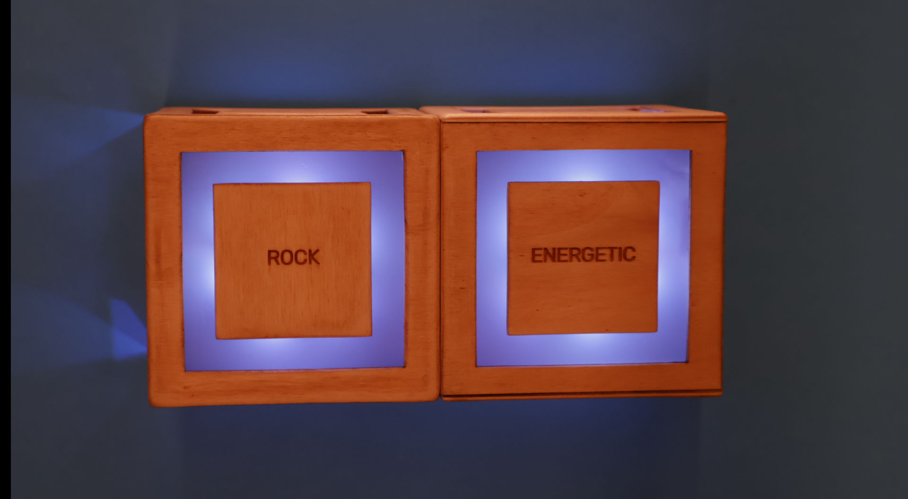

# Cubit

> Two cubes you rotate to mix a mood and a genre, and discover new music.

<!-- Upload a picture called cover.jpg to the images folder and it will appear here. -->

## Team

- Ella Park
- Maryam Safai Fard
- Daniela Gómez

## About the project

Cubit is made of two cubes. One cube chooses the genre and the other one chooses the mood (the energy of the music). Each face of a cube has a different option. When the cubes are apart the device is off. When you put them together it turns on, and when you stop rotating them it starts playing a track that matches your combination.

The track is always a bit unexpected, so every combination is a small discovery, and a way of interacting with AI through your hands instead of a screen.

## How it works

1. The user rotates the Genre cube and the Mood cube to choose an option on each.
2. An accelerometer in each cube detects which face is up.
3. The cubes talk to each other over Wi-Fi.
4. When the cubes are connected and held still, the Arduino Uno Q asks the Claude API to create a query from the selection.
5. The query is used to find a matching track on Spotify, which starts playing.

## Hardware and services

- Arduino Uno R4 (in one cube)
- Arduino Uno Q (in the other cube)
- One accelerometer per cube
- Independent battery in each cube
- Wi-Fi communication between the cubes
- APIs: Claude, Spotify

<!-- Team: please check this list and complete it with the exact components and libraries you used. -->

## What is in this folder

| Folder | What you will find |
|---|---|
| [`code/`](code/) | Source code (Arduino, Python, server) |
| [`schematics/`](schematics/) | Wiring diagrams, bill of materials, fabrication files |
| [`images/`](images/) | Photos of the prototype and the process |
| [`presentation/`](presentation/) | Final presentation and other documents |

## How to build it

<!-- Team: write the steps someone would need to follow to make this project work.
     For example:
     1. Build the circuit following schematics/...
     2. Install these libraries: ...
     3. Copy code/secrets.example.h to code/secrets.h and add your API keys
     4. Upload code/arduino/... to the board
     5. ... -->

*Coming soon.*

## License and credits

This project is the intellectual property of its authors: **Ella Park, Maryam Safai Fard and Daniela Gómez**.

It is shared under the [Creative Commons Attribution 4.0 International (CC BY 4.0)](https://creativecommons.org/licenses/by/4.0/) license. You are free to use, adapt and share it, also commercially, as long as you **credit the authors**. You can use this text:

> *Cubit* by Ella Park, Maryam Safai Fard and Daniela Gómez. Created for the Tangible User Interfaces course 2025/26 at the Copenhagen Institute of Interaction Design (CIID). Licensed under CC BY 4.0. https://www.ciid.dk/idp-projects/cubit
